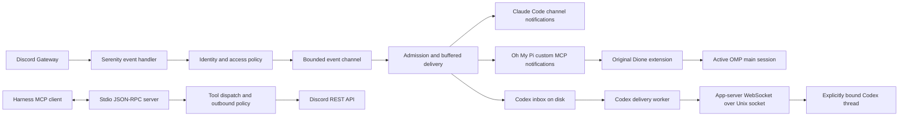

# Dione architecture

Dione is a Rust communication bridge for Claude Code, Codex, and Oh My Pi.
The agent host owns generative inference and conversation state. Dione owns
Discord access policy, event delivery, and MCP tools. Optional Teams ingress
and event-bound replies support Codex and saved Oh My Pi sessions.

This map describes the implementation assembled by [startup.rs](src/startup.rs).
The executable [main.rs](src/main.rs) installs error reporting and calls the
library's process startup entry.
The [adopted three-machine target](docs/design/architecture.md) is a separate
contract; its bridge-wide custody, turn, effect, and supervisor guarantees are
not all present in this implementation. PR551's typed module boundaries and
specific durable owners do not by themselves establish every target guarantee.
The former design on this page proposed direct Anthropic inference, SQLite,
Qdrant, and local ONNX embeddings. Those are historical proposals, not the
runtime or dependencies in [Cargo.toml](Cargo.toml).

## Workspace capabilities

The `dione` package composes platform adapters, harnesses, and MCP tools.
The public `dione-rendering` package owns LaTeX conversion, Typst compilation,
PNG encoding, and retained files. Its successful artifact types have private
fields; compiler and persistence errors retain their concrete causes.
The public `dione-durable` package owns generic queue state transitions,
accepted-operation lifetime, and atomic snapshot replacement. Codex and Oh My Pi
retain their adapter-specific codecs and payload validation. Rook uses the same
atomic replacement primitive while retaining its private-directory admission.
The public `dione-contracts` package owns source-qualified provider identities,
context records, and checked message occurrences. Literal identity formatting
belongs to `dione-identity-display`; delivery values belong to `dione-messages`.
Rook retains its own
serialized observation model and authorization checks.
The public `dione-rook` package owns durable recipients, callback scheduling,
context reads, and publication slots. Its private snapshot keeps claim and
publication commits together. Discord retains current policy checks, native
observation conversion, and HTTP transport behind Rook's existing provider traits.
The public `dione-attention` package owns judgments, source-bound metadata,
feedback, replay, evaluation, and learning. The upper `dione-recipient-attention` library owns current source policy, runtime scheduling, controls and the complete notification delivery lifecycle; Dione composes its concrete inputs. The engine preserves
its existing Serenity identity types and provider HTTP implementation.
The public `dione-evidence` package owns terminal sentex syntax, checked handle
arguments, supplied-author JSON projection, and the Markdown scanner shared by
chunking, status lint, and filtering. It has no attention or delivery dependency.
Discord still supplies authenticated authorship and enforces current policy.
The public `dione-messages` package owns observed events, nonempty ordinary
deliveries, managed source descriptors, and timestamps.
Dione retains timezone configuration and current dispatch authority. Message
values describe supplied observations rather than granting access or permission.
The public `dione-rate-limiter` package owns scoped configuration resolution and
explicit-time token buckets for participant/channel pairs. Dione retains admission,
key construction, live reload scheduling, and the action taken after denial.
The public `dione-vaelii` package owns the optional provenance receipt client.
Discord retains message authorization, lookup, exact-target checking, projection,
and receipt failure handling. The client records supplied identifiers without
message content or an authority claim.
The public `dione-gaie` package owns durable archives, retained origin bytes,
scoped Discord backfill, attachment budgets, and latest-state replay. Its private
origin and checkpoint protocol stays together. Dione retains archive configuration,
credential loading, channel allowlists, and the archive executable.
The public `dione-identity-display` package owns literal formatting and the
existing nameplate/PronounDB clients. Dione keeps service construction, settings,
bot/human routing, and current exclusion decisions. The clients share the formatter
directly and have no messages or attention dependency.
The public `dione-harness` package owns one-adapter delivery/protocol facets and
bounded shared JSON-line output. The `dione-harness-runtime` package owns provider
selection and session lifecycle, constructing adapters from `dione-omp`,
`dione-codex`, and `dione-claude`. Dione composes startup, native request-origin
authority, and private-control registration around those owners.
The public `dione-presentation` package owns retained delivery projection and
compact batch formatting. Dione retains provider envelopes, legacy scope validation,
and native event conversion. Projection checks no current authorization.
The public `dione-contradictionary` package owns text matching, conservative
automatic rewrites, and sidecar entry compatibility. It uses the shared evidence
Markdown scanner. Dione retains raw configuration, rule composition, diary
decisions/persistence, current send authorization, and no_rly consent.
See the [crate split plan](docs/design/plugin-crates.md) for the next boundaries
and the package release requirements.

The public `dione-bell-rings` package owns validated recall/provider values,
reconnectable MCP clients, scope-keyed caching, two-phase fan-out, response admission,
ranking, retrieval status and compact rendering. Dione retains native eligibility,
configuration/alias policy, shadow/live orchestration and metadata injection. No
Discord or Dione application dependency enters the retrieval member.

The public dione-delivery-scheduler package owns the generic per-conversation
FIFO, deadlines, bounded immediate budgets, requeue, and ordered drain.
Discord retains evidence classification and native notification ownership.
MCP retains admission, rate-limit handling, runtime delivery, and shutdown wiring.

The public dione-access-requests package owns pending request storage,
queue.json persistence, and administrator-notification cooldown bookkeeping.
Dione retains current authorization, configuration-backed approval, async locks,
administrator delivery, and pruning task lifetime.

The public dione-mutes package owns receipt replay, mute projections, mutation,
clock and expiry mechanics. Application composition owns the existing global
handle. Dione retains current authorization, MCP TTL validation, startup ordering,
and explicit worker abort during normal shutdown.

The public dione-coordination package owns the checked reply-coordination client,
wire protocol, shared event bus and gateway identity fallback. Checked acquisition
retains partial-write uncertainty and closes waiting connections; ordinary claims
subscribe to pushes. Dione retains configuration, current authorization, Rook
publication policy and bookkeeping.

The public dione-teams-identities package owns six distinct validated opaque
Teams coordinates and their typed errors. Configuration, native authentication
and persisted reply authority import the owning crate directly. Original spelling
is preserved; valid coordinate syntax grants no authorization.

The public dione-discord-identities package owns the existing nonzero external
Discord input validator and four Serenity ID conversions. Config,tools,search and
persisted codecs import it directly while retaining their adapter-level parsing
and current native authority checks.

The public dione-pluralkit-identities package owns configured PK UUID validation
and the official deployment application ID. Configuration imports its private
validated UUID and typed errors. Verified-action classification imports the
constant while retaining configured trust and private proof construction.

The public dione-config package owns settings, validated resource assembly,
comment-preserving editing, candidate/sidecar merge, recovery, and one global
publication writer/cache/counter/watch channel. Application admission acquires
that same writer through its narrow guard API. File watching and native process
lifetimes remain application adapters.

The public dione-outbound-consent package owns consent decisions, held retries,
journal maintenance, deferred diary records and fence-aware chunking. Native
senders retain HTTP, authorization and coordination effects. Their terminal
failure projection consumes typed progress and diary records; consent retries
retain private remainder and fence state inside the owner.

The public dione-mcp-tools package owns validated tool names, definitions,
immutable registrations and borrowed handler contracts. Application server
assembly supplies the current reserved-name set from fixed harness names,
actual selected-harness discovery and private controls at both construction
paths. Transport origin, readiness, resident admission and native authority
remain application-owned.

The public dione-provider-delivery package owns concrete persisted provider
replay keys, descriptive Teams resident events, borrowed admission sinks and
reply-handle syntax. Codex and OMP retain distinct codecs and replay ordering.
Teams retains private authentication, sealed authority, current policy and
prepare/consume/send sequencing. Typed UUID conversion formats syntax; random
handle generation stays private to its runtime.

The [dione-teams owner](crates/dione-teams/src/lib.rs) contains native JWT and
scope validation, metadata retrieval, sealed reply authority, durable storage,
HTTP ingress, owned replies, listener lifecycle and Teams MCP handling. Native
authenticated values, tokens, prepared requests and fault hooks remain private.
Provider-owned [OMP admission](crates/dione-omp/src/teams_delivery.rs) and
[Codex admission](crates/dione-codex/src/teams_delivery.rs) connect the shared
descriptive sink to their actual queues. Startup still assembles
and stops these services. Private test-process fixtures preserve actual composed
queue/tool/native HTTP cases without exporting authority constructors.

## Processes and transports

The default `dione` mode is `claude-code`. All modes expose MCP requests and
responses on stdin and stdout. Logs use stderr and an optional log file.
[server.rs](src/mcp/server.rs) implements line-delimited JSON-RPC directly so
responses and channel notifications can share stdout.

[HarnessConnection](crates/dione-harness/src/connection.rs) couples delivery and MCP
capabilities from one adapter instance. Shared routing uses that connection;
the CLI selects the concrete adapter during construction. The
[Claude adapter](crates/dione-claude/src/lib.rs) shares one serialized output with MCP
responses. The [Codex adapter](crates/dione-codex/src/adapter.rs) owns the queue-tool schemas,
argument handling, queue delivery, and live binding publisher. Attention's
[delivery contracts](crates/dione-attention/src/delivery.rs) belong to the attention
module and are consumed by the concrete worker.

The [Oh My Pi adapter](crates/dione-omp/src/adapter.rs) validates rendered events and
projects versioned `notifications/dione/event` frames through the same output
writer. Its [extension](extensions/oh-my-pi/dione.ts) validates the exact server,
method, and payload, then submits the full event to the main agent. It uses the
direct attention policy and exposes ordinary tools without Claude permission
relay. Generic Discord notifications have no durable inbox, acknowledgment,
or replay guarantee.

Optional Teams ingress uses the [OMP session owner](crates/dione-omp/src/lib.rs)
with a durable inbox and private Unix controls. The
[Teams extension bridge](extensions/oh-my-pi/teams.ts) binds an exact saved main
session and acknowledges only an exact receipt synchronized to its file-backed
transcript. Pending events can replay; native event identities deduplicate them.
This receipt records durable assistant admission, not inference or reply success.
The [operator guide](extensions/oh-my-pi/README.md#saved-session-teams-delivery)
defines conversation admission, file storage, and socket requirements.

[HarnessSession](crates/dione-harness-runtime/src/session.rs) owns preparation and consumes itself
into a running session after attention initialization. The
[Codex session](crates/dione-codex/src/session.rs) owns configuration resolution,
initial binding, the queue, and the existing reconnect worker. Its delivery
cancellation remains independent while process ingress and replies drain.
Shutdown joins the worker before releasing the retained connection.

In Claude Code mode, accepted events become channel notifications on stdout.
In Codex mode, the notification sink writes events to the local inbox.
[app_server.rs](crates/dione-codex/src/app_server.rs) leases events and sends them to an
explicit thread through a WebSocket over the local app-server Unix socket.
Ordinary delivery starts an idle turn or steers an active turn. Attention-managed
ambient delivery waits for an idle opportunity and does not steer an active turn.

The worker acknowledges an event after the app-server accepts its request.
Acceptance is a transport outcome, not proof that the agent read or acted on the
event. The MCP lease and acknowledgement tools also support explicit pull
consumers. The [Codex queue adapter](crates/dione-codex/src/queue.rs) projects the legacy API onto the
[durable queue owner](crates/dione-durable/src/queue.rs), which serializes consumer, lease,
and binding transitions. Its [store](crates/dione-durable/src/store.rs) holds the lifetime
inbox lock and persists snapshots through the [legacy codec](crates/dione-codex/src/queue_codec.rs). The [Codex setup guide](README.md#codex-mode) describes binding
and intentional backlog handoff.

The workspace contains capability libraries and the Dione application package
with a library and three executables.
`dione` runs the bridge. [dione-send](src/bin/dione-send.rs) sends once without
the gateway. [gaie_archive](src/bin/gaie_archive.rs) owns archive capture and
replay commands. There is no required Kubernetes or database deployment in
the startup assembly.

## Discord ingress and admission

[client.rs](crates/dione-discord-runtime/src/client.rs) builds the Serenity client and requests
gateway intents. [events.rs](crates/dione-discord-runtime/src/events.rs) handles messages, edits,
deletions, reactions, interactions, and presence state.

Each message handler loads the current immutable configuration snapshot.
[gate.rs](crates/dione-discord-gate/src/lib.rs) applies DM policy, configured channels, allowlists,
identity ignores, and targeting rules. Unknown DM senders can enter the bounded
[access request queue](crates/dione-access-requests/src/lib.rs) for admin review. Guild mutes suppress
delivery through the [mute store](crates/dione-mutes/src/lib.rs).

Webhook identity follows a separate path. The
[runtime verifier](crates/dione-discord-runtime/src/verified_action_runtime.rs) observes the webhook
creator and resolves supported PluralKit identity before the
[verified-action gate](crates/dione-discord-runtime/src/verified_action.rs) admits an action.
Display names and webhook payload IDs alone are not user authority.
[principal_policy.rs](crates/dione-discord-gate/src/principal_policy.rs) holds the typed principal policy.
The [ingress ledger](crates/dione-discord-runtime/src/ingress.rs) retains private lineage admission and current policy authority for edits, deletes, reply context, and subsequent reads. Its [lifecycle storage controller](crates/dione-discord-events/src/lifecycle_storage.rs) owns bounded retention, sequence allocation, content ordering and tombstones. Runtime authority checks and storage mutations share one borrowed critical section; retained metadata grants no authority.

Admitted events enter a Tokio channel with capacity 256. The notification task
in [recipient forwarding](crates/dione-recipient-attention/src/forwarding.rs) applies rate limits and optional attention
evaluation, then buffers and coalesces ordinary delivery through
[Discord scheduling](crates/dione-discord-scheduling/src/lib.rs) and [delivery scheduler](crates/dione-delivery-scheduler/src/lib.rs).
[Discord event contracts](crates/dione-discord-events/src/lib.rs) own descriptive observations and targeting reasons. [Discord delivery conversion](crates/dione-discord-events/src/delivery.rs) constructs typed batches, and
[dione-presentation](crates/dione-presentation/src/lib.rs) projects deliveries for each harness.
The buffer is in memory;
entering the gateway channel is not a durable inbox commit.

[Recipient Attention](crates/dione-recipient-attention/src/lib.rs) adds optional recipient-local ambient
admission. The [admission controller](crates/dione-attention-admission/src/lib.rs) owns recipient-local work ordering, cancellation and completion fences. Its returned metadata grants no delivery authority. The recipient runtime owns source validation, evaluation, learned-policy
receipts, and transport outcome records. It is disabled by default. The
[attention guide](docs/attention.md) describes modes and promotion requirements.
[Bell evaluation](crates/dione-discord-bells/src/lib.rs) can attach memory recall metadata from
configured MCP providers in shadow or live mode.

## Tools and outbound actions

[MCP response contracts](crates/dione-mcp-protocol/src/lib.rs) define protocol negotiation and the thirty-three built-in discovery schemas.
[Discord reply contracts](crates/dione-discord-tool-contracts/src/reply.rs) own the reply schema
and argument parsing. [Discord reply registration](crates/dione-discord-operations/src/reply_tool.rs) keeps execution
and evidence-dependent discovery using the current configuration.
[dispatch.rs](src/mcp/dispatch.rs) loads a fresh configuration snapshot for a
tool call and routes it to Discord operations and the remaining
[tool handlers](src/mcp/tools).
The current request loop awaits each handler before reading the next request.
A slow handler can therefore delay later requests and cancellation handling.

[Messaging handlers](crates/dione-discord-operations/src/messaging.rs) perform destination access
checks and use Serenity HTTP for Discord operations. File uploads pass the
canonical-path guard in [gate.rs](crates/dione-discord-gate/src/lib.rs), which excludes the state
directory except its attachment inbox. Fetch and download operations also
have their own access checks; an MCP connection is not unrestricted Discord
access.

Discord replies, DMs, and consent actions return typed outcomes. The
[Discord messaging adapter](crates/dione-discord-messaging-contracts/src/wire.rs) projects tool response fields.
[Discord queries](crates/dione-discord-queries/src/queries.rs) own authorized message reads,
receipt attempts, and attachment downloads. Their private result fields preserve
message ordering and derive page metadata. The [Discord query adapter](crates/dione-discord-queries/src/wire.rs)
formats these results, including receipt failures that leave a message read successful.
[Discord search](crates/dione-discord-queries/src/search.rs) owns prepared search requests,
HTTP execution, current channel permission checks, and typed result pages. Search
shares the message observation while retaining transport order and duplicates.
Its continuation hint measures raw Discord result groups before filtering.
The [Discord search adapter](crates/dione-discord-queries/src/search_wire.rs) preserves argument parsing and
response formatting, including the separate argument and tool-result errors.

[Access decisions](crates/dione-access-requests/src/workflow.rs) own complete listing, approval,
and denial operations. Private receipts reuse configuration durability to describe
approval outcomes. Unknown durability retains the pending request for retry.
Queue persistence remains best effort, so durable configuration does not prove
durable queue removal. The [Access wire projection](crates/dione-access-requests/src/wire.rs) formats
responses. Dispatch preserves the existing mutation-disable switch before ID
parsing and leaves listing ungated.

[Discord management](crates/dione-discord-operations/src/management.rs) owns authorized pin, unpin,
delete, and thread creation. A complete message command selects a mutation;
thread creation returns its own typed result and registers the requested parent
before returning. The narrow context contains HTTP, state, configuration, and
the ingress ledger. The [management result contract](crates/dione-discord-messaging-contracts/src/management/wire.rs)
owns descriptive thread metadata, typed errors and their JSON projection. [Management contracts](crates/dione-discord-tool-contracts/src/management.rs)
own argument parsing; [registered management tools](crates/dione-discord-operations/src/management_tools.rs) keep registration and execution.

[Discord introspection](crates/dione-discord-introspection/src/introspection.rs) owns guild, channel, user,
member, role, and emoji reads. It returns typed observations and failures,
resolves private-channel names through the SDK, and localizes member join times
using the configuration selected at call entry. These reads use the bot HTTP
client's authority and have no local allowlist or ingress checks. The
[Discord introspection adapter](crates/dione-discord-introspection/src/wire.rs) formats results and
original SDK error text. [Metadata contracts](crates/dione-discord-tool-contracts/src/metadata.rs)
own argument parsing; [registered introspection tools](crates/dione-discord-operations/src/introspection_tools.rs) keep registration and execution.

[Consent delivery types](crates/dione-outbound-consent/src/delivery.rs) distinguish total failure from
nonempty partial progress and retain retry state privately. Attention consumes
the same typed outcomes and treats only complete delivery as success.

[dione-pre-send](crates/dione-pre-send/src/lib.rs) owns the hook runner, private
status lint and production roster. [Installed pipeline registry](crates/dione-pre-send/src/registry.rs)
installs the production pipeline in Observe mode. Observe records findings without changing or stopping output. Separately,
the [no_rly consent gate](crates/dione-outbound-consent/src/consent.rs) can hold rejected message text
for an explicit release or rephrase. Its pending handles are in memory, while
resolved outcomes go to the journal. These are different mechanisms.

[permissions.rs](crates/dione-permissions/src/lib.rs) relays Claude Code permission requests to
configured Discord admins. Permission button responses are separate from
ordinary message admission. [one-shot owner](crates/dione-oneshot/src/lib.rs) implements the bounded
one-shot send path with an explicit expected bot identity, described in the
[one-shot guide](docs/oneshot-send.md).

[presence owner](crates/dione-discord-presence/src/lib.rs) owns typed requests, the shared presence
authority, queue acceptance, and reconnect replay. Its [wire contract](crates/dione-discord-presence/src/wire.rs) owns MCP request decoding and honest local-result projection; root dispatch retains concrete capability calls. [Discord introspection](crates/dione-discord-introspection/src/lib.rs) owns metadata, visibility and bounded audience observations with wire projection; resident admission remains at root; the tool catalog owns descriptive schemas and argument decoding. [Discord typing](crates/dione-discord-typing/src/lib.rs)
authorizes and sends typing notifications. The public
[`dione-discord-identities`](crates/dione-discord-identities/src/lib.rs) owner validates
external Discord IDs through `dione_discord_identities::Snowflake`.
Production gateway code uses the Discord owners directly. The [Discord tool catalog](crates/dione-discord-tool-contracts/src/lib.rs) owns the twenty remaining root-adapted tool definitions and typed request decoding. Root MCP adapters retain current configuration, resident registration and execution; the MCP response library owns built-in discovery metadata. Application messaging lives in
`dione_discord_operations::messaging`; the former MCP messaging and ID aliases were removed.
The former
`mcp::tools::bot_state` alias was removed in 0.53.0.

## State and ownership

[config.rs](crates/dione-config/src/config.rs) resolves `DIONE_STATE_DIR`, defaulting to
`~/.claude/channels/dione`. The config path can be overridden separately.
Stores below have distinct commit and recovery rules; a file named here does
not imply that all writes have the same durability guarantee.

| State | Owner and representation |
|-------|--------------------------|
| Configuration | [ConfigRuntime](crates/dione-config/src/config.rs) serializes mutations and publishes immutable snapshots through ArcSwap. TOML, last-known-good, and quarantine files support recovery. [ConfigStore](crates/dione-config/src/config_store.rs) edits TOML without owning persistence. |
| Access requests | [AccessQueue](crates/dione-access-requests/src/lib.rs) keeps requests in memory and writes `queue.json` through a temporary file and rename. Persistence errors are logged after memory changes. |
| Codex delivery | [CodexEventQueue](crates/dione-codex/src/queue.rs) adapts the shared [durable owner](crates/dione-durable/src/queue.rs); its [legacy codec](crates/dione-codex/src/queue_codec.rs) preserves pending events, leases, consumers, and bindings in `codex-inbox.json`. The [store](crates/dione-durable/src/store.rs) holds `codex-inbox.lock` for its lifetime to exclude a second owner. |
| Guild mutes | [MuteStore](crates/dione-mutes/src/lib.rs) rebuilds state from `guild_mute_receipts.jsonl`. Receipt append precedes snapshot publication. |
| Attention | [AttentionRuntime](crates/dione-recipient-attention/src/runtime.rs) uses `attention/records.json` through the [attention store](crates/dione-attention/src/store.rs) and its [private serialized access controller](crates/dione-attention/src/store_access.rs), plus the [health lifecycle controller](crates/dione-attention/src/health.rs) for serialized backoff, notice bookkeeping and `attention-status.json` persistence. The recipient owner retains the single initialization worker and current notice route, consent and transport authority; root composes the existing concrete resources. |
| Consent outcomes | [JournalHandle](crates/dione-outbound-consent/src/journal.rs) serializes writes to `no_rly_journal.jsonl`. Pending consent handles are owned by [HoldQueue](crates/dione-outbound-consent/src/queue.rs). |
| Attachments | [Discord queries](crates/dione-discord-queries/src/queries.rs) download Discord attachments into the state directory's `inbox/`. |
| Transient Discord state | [shared Discord state](crates/dione-discord-state/src/lib.rs) holds entity caches, DM indexes, sent-message identities, and permission requests. The [ingress ledger](crates/dione-discord-runtime/src/ingress.rs), delivery buffer, and rate limiter are also process-local. |
| Archive data | The separate [GAIE archive](crates/dione-gaie/src/archive.rs) owns corpus NDJSON, checkpoints, attachment data, origin evidence, and archive locks. See the [archive guide](docs/gaie-archive.md). |

The [config watcher](crates/dione-config-watcher/src/lib.rs) reloads changed files through
ConfigRuntime. Loading a snapshot does not re-read TOML on every message.
Snapshots, generation notifications, and writer authority are process-global;
separate ConfigRuntime values do not create independent configuration instances.
At this implementation, startup captures pronoun and nameplate service
settings, the access-request pruning expiry, and Codex preamble settings.
Publishing a new snapshot does not reconstruct those captured values.
[startup.rs](src/startup.rs) is the authority for those construction-time choices.

## External integrations and dependencies

| Integration | Implementing code and purpose |
|-------------|-------------------------------|
| Discord Gateway and REST | [Serenity client](crates/dione-discord-runtime/src/client.rs), [events](crates/dione-discord-runtime/src/events.rs), [messaging](crates/dione-discord-operations/src/messaging.rs), [presence](crates/dione-discord-presence/src/lib.rs), [typing](crates/dione-discord-typing/src/lib.rs), and the remaining [tools](src/mcp/tools) receive events and execute authorized operations. |
| Codex app-server | [Delivery worker](crates/dione-codex/src/app_server.rs) addresses an exact local thread. |
| PluralKit | [Identity resolver](crates/dione-pluralkit-resolver/src/lib.rs) resolves supported proxy identity. |
| Pronouns and nameplates | [Pronoun service](crates/dione-identity-display/src/pronouns.rs) and [nameplate service](crates/dione-identity-display/src/nameplates.rs) enrich display metadata when enabled. |
| Memory MCP providers | [Bell evaluator](crates/dione-discord-bells/src/lib.rs) uses `rmcp` Streamable HTTP clients for configured recall providers. This is separate from Dione's stdio MCP server. |
| TypeSafe System One | [Attention provider](crates/dione-attention/src/provider.rs) scores eligible ambient text with bounded requests. It does not replace the agent host's generative inference. |
| Vaelii | [Receipt bridge](crates/dione-vaelii/src/lib.rs) writes provenance for explicit message reads when configured. Sentex locators are handled by [dione-evidence](crates/dione-evidence/src/lib.rs). |

[Cargo.toml](Cargo.toml) is the dependency inventory. The main runtime uses
Tokio, Serenity, serde, ArcSwap, and tracing. Reqwest supports HTTP integrations.
Typst, its renderer and fonts, and mitex support [PNG rendering and retained files](crates/dione-rendering/src/lib.rs).
[Discord rendering](crates/dione-discord-operations/src/rendering.rs) authorizes and sends math attachments;
The rendering member [file contract](crates/dione-rendering/src/wire.rs) projects retained-file results and rendering failures. The root [channel projection](crates/dione-discord-operations/src/render_wire.rs) retains Discord messaging results.
The package currently requires Rust 1.98 and edition 2024. Unix sockets and Unix
signal handling appear in the runtime, so this map does not claim native Windows
support. The [justfile](justfile) defines `just check` and the broader
`just pre-push`; [coding standards](CODING_STANDARDS.md#task-completion-checklist)
describe the repository's code-change checks.

## Task ownership and shutdown limits

[startup.rs](src/startup.rs) retains handles for Discord, MCP, Teams ingress,
resident control, and mute expiry. The running harness session owns the Codex
delivery worker or optional OMP Teams session actor. Config watching, trace forwarding, coordination
forwarding, and access-request pruning also run as background tasks.
The trace channel is bounded by [the tracing channel owner](crates/dione-tracing-channel/src/lib.rs).

SIGINT, SIGTERM, or internal cancellation starts shutdown. Startup cancels the
shared token, aborts Discord and mute expiry, joins Teams ingress, resident
control, and MCP, then drains accepted Teams replies. The harness session
then cancels and joins delivery before releasing its retained connection.
These outer joins have no deadline. MCP separately gives its notification and consent sweep tasks
500 milliseconds each. The notification task attempts a final buffer flush;
the consent sweeper resolves pending holds as expired.

OMP stdin EOF shuts down the child even when a resident control socket exists.
Only Codex with resident control detaches stdio on EOF. Shutdown attempts all
owned drains before returning the first join error. The main runtime then uses
`shutdown_background` so an uncancellable stdin read does not hold process exit.
MCP ignores its task timeout results.
Several spawned task handles are not retained by startup. The final
`dione stopped` log is therefore
not proof that every task drained, every buffered event reached a consumer,
or every journal write reached disk.

The [drop ledger](crates/dione-drop-ledger/src/lib.rs) owns per-scope retention and
reply inheritance; native admission and canonical fallback retain their policy checks.

The [permission owner](crates/dione-permissions/src/lib.rs) sends admin prompts and
handles current-admin acknowledgements, sibling cleanup, and decision forwarding.

The [native Bell owner](crates/dione-discord-bells/src/lib.rs) selects message
eligibility and orchestrates shadow/live enrichment. Generic retrieval and rendering
remain separate from native delivery admission and source revalidation.

The [native gate owner](crates/dione-discord-gate/src/lib.rs) contains DM, guild,
reaction, reply-parent, mention, outbound file/channel, and principal translation
policy. Guild checks borrow the existing live MuteStore; root composition retains
the only singleton and callers retain verified-action authority.

Discord message read, search, attachment and native observation ownership resides in [dione-discord-queries](crates/dione-discord-queries/src/lib.rs). Root query registrations retain resident admission, argument parsing and call-entry configuration. QueryCtx carries read dependencies only; typed native observations do not confer sealed ingress or delivery authority.

[Discord Rook context reads](crates/dione-discord-context/src/lib.rs) own the context provider and bounded native metadata projection. The trusted embedding supplies fresh read-only QueryCtx values; the root retains sealed live observation capture. This extraction adds no production registration.

[Shared Discord tool arguments](crates/dione-discord-tool-arguments/src/lib.rs) own typed argument validation and evidence handle schema projection. Root tool registrations retain parsing order, current configuration, authorization and execution authority.

[Discord messaging contracts](crates/dione-discord-messaging-contracts/src/lib.rs) own descriptive outcomes, error metadata and JSON projection. The Discord operations owner retains destination checks, consent coordination and effect bookkeeping; the gateway runtime owns ingress verification.

[Discord tool contracts](crates/dione-discord-tool-contracts/src/lib.rs) own metadata, query, management and reply catalogs without access or execution authority. Root execution adapters use these requests directly.

[PluralKit fact resolution](crates/dione-pluralkit-resolver/src/lib.rs) owns provider HTTP, response-coordinate checks, retry bounds and the facts-only cache. The [root sealed adapter](crates/dione-discord-runtime/src/verified_action_runtime.rs) projects verified event coordinates into an ordinary lookup and consumes returned facts through the existing private action transition. The provider library grants no lifecycle or policy authority.

[Attention control commands](crates/dione-attention/src/control.rs) own the twelve-operation decoder, descriptive mutation classification and MCP schema in the existing Attention library. The [recipient executor](crates/dione-recipient-attention/src/control.rs) retains authentication-derived recipient context, current configuration and source checks, lifecycle state and durable effect admission. A decoded command is not permission to execute it.

[MCP response contracts](crates/dione-mcp-protocol/src/lib.rs) own protocol negotiation and the thirty-three built-in discovery definitions. The [root server](src/mcp/server.rs) supplies its application version and current harness capability/tool snapshots, then retains authentication, installed registration, current configuration, execution and lifecycle hooks. Discovery metadata grants no authority.

The registered Discord gateway runtime owns its verification producers and policy/lifecycle enforcers together. Root composition supplies concrete services and shares the enforcing ledger with MCP and Attention; proof constructors remain private inside the runtime. Process-global mute installation has one registry in `dione-mutes`. Observation remains disabled at startup.

[Discord operations](crates/dione-discord-operations/src/lib.rs) own complete authorized SDK effects and their actual shared tool registrations. Root assembles the same concrete services, immutable tool registry and Attention notice caller; private prepared outbound and target policy stay inside the operation owner. The [pre-send registry](crates/dione-pre-send/src/registry.rs) is the single installed pipeline used by startup and newly constructed operation contexts. No production Rook provider or observation registration is added.

### MCP session ownership

`dione-mcp-session` owns immutable owner registrations, JSON-RPC request dispatch, private resident admission and stdio/resident task lifetimes. Process startup supplies the application version and concrete capabilities, starts the harness and transports, and retains process signal and final drain ordering. Request origins, registry mutation and test helpers stay private to the session library.
