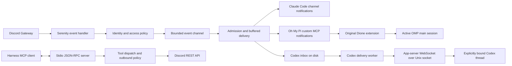

# Dione architecture

Dione is a Rust communication bridge for Claude Code, Codex, and Oh My Pi.
The agent host owns generative inference and conversation state. Dione owns
Discord access policy, event delivery, and MCP tools. Optional Teams ingress
and event-bound replies support Codex and saved Oh My Pi sessions.

This map describes the implementation assembled by [startup.rs](src/startup.rs).
The executable [main.rs](src/main.rs) installs error reporting and calls the
library's process startup entry.
The former design on this page proposed direct Anthropic inference, SQLite,
Qdrant, and local ONNX embeddings. Those are historical proposals, not the
runtime or dependencies in [Cargo.toml](Cargo.toml).

## Processes and transports

The default `dione` mode is `claude-code`. All modes expose MCP requests and
responses on stdin and stdout. Logs use stderr and an optional log file.
[server.rs](src/mcp/server.rs) implements line-delimited JSON-RPC directly so
responses and channel notifications can share stdout.

[HarnessConnection](src/harness/connection.rs) couples delivery and MCP
capabilities from one adapter instance. Shared routing uses that connection;
the CLI selects the concrete adapter during construction. The
[Claude adapter](src/harness/claude.rs) shares one serialized output with MCP
responses. The [Codex adapter](src/harness/codex.rs) owns the queue-tool schemas,
argument handling, queue delivery, and live binding publisher. Attention's
[delivery contracts](src/attention/delivery.rs) belong to the neutral attention
module and are consumed by the concrete worker.

The [Oh My Pi adapter](src/harness/oh_my_pi.rs) validates rendered events and
projects versioned `notifications/dione/event` frames through the same output
writer. Its [extension](extensions/oh-my-pi/dione.ts) validates the exact server,
method, and payload, then submits the full event to the main agent. It uses the
direct attention policy and exposes ordinary tools without Claude permission
relay. Generic Discord notifications have no durable inbox, acknowledgment,
or replay guarantee.

Optional Teams ingress uses the [OMP session owner](src/harness/omp_session.rs)
with a durable inbox and private Unix controls. The
[Teams extension bridge](extensions/oh-my-pi/teams.ts) binds an exact saved main
session and acknowledges only an exact receipt synchronized to its file-backed
transcript. Pending events can replay; native event identities deduplicate them.
This receipt records durable assistant admission, not inference or reply success.
The [operator guide](extensions/oh-my-pi/README.md#saved-session-teams-delivery)
defines conversation admission, file storage, and socket requirements.

[HarnessSession](src/harness/session.rs) owns preparation and consumes itself
into a running session after attention initialization. The
[Codex session](src/harness/codex_session.rs) owns configuration resolution,
initial binding, the queue, and the existing reconnect worker. Its delivery
cancellation remains independent while process ingress and replies drain.
Shutdown joins the worker before releasing the retained connection.

In Claude Code mode, accepted events become channel notifications on stdout.
In Codex mode, the notification sink writes events to the local inbox.
[app_server.rs](src/codex/app_server.rs) leases events and sends them to an
explicit thread through a WebSocket over the local app-server Unix socket.
Ordinary delivery starts an idle turn or steers an active turn. Attention-managed
ambient delivery waits for an idle opportunity and does not steer an active turn.

The worker acknowledges an event after the app-server accepts its request.
Acceptance is a transport outcome, not proof that the agent read or acted on the
event. The MCP lease and acknowledgement tools also support explicit pull
consumers. The [Codex queue adapter](src/codex/queue.rs) projects the legacy API onto the
[durable queue owner](src/durable/queue.rs), which serializes consumer, lease,
and binding transitions. Its [store](src/durable/store.rs) holds the lifetime
inbox lock and persists snapshots through the [legacy codec](src/codex/queue_codec.rs). The [Codex setup guide](README.md#codex-mode) describes binding
and intentional backlog handoff.

The repository contains one package with a library and three executables.
`dione` runs the bridge. [dione-send](src/bin/dione-send.rs) sends once without
the gateway. [gaie_archive](src/bin/gaie_archive.rs) owns archive capture and
replay commands. There is no required Kubernetes or database deployment in
the startup assembly.

## Discord ingress and admission

[client.rs](src/discord/client.rs) builds the Serenity client and requests
gateway intents. [events.rs](src/discord/events.rs) handles messages, edits,
deletions, reactions, interactions, and presence state.

Each message handler loads the current immutable configuration snapshot.
[gate.rs](src/gate.rs) applies DM policy, configured channels, allowlists,
identity ignores, and targeting rules. Unknown DM senders can enter the bounded
[access request queue](src/queue.rs) for admin review. Guild mutes suppress
delivery through the [mute store](src/mute_store.rs).

Webhook identity follows a separate path. The
[runtime verifier](src/discord/verified_action_runtime.rs) observes the webhook
creator and resolves supported PluralKit identity before the
[verified-action gate](src/discord/verified_action.rs) admits an action.
Display names and webhook payload IDs alone are not user authority.
[principal_policy.rs](src/principal_policy.rs) holds the typed principal policy.
The [ingress ledger](src/ingress_ledger.rs) retains admitted lifecycle evidence
for edits, deletes, reply context, and subsequent reads.

Admitted events enter a Tokio channel with capacity 256. The notification task
in [server.rs](src/mcp/server.rs) applies rate limits and optional attention
evaluation, then buffers and coalesces ordinary delivery through
[scheduling.rs](src/discord/scheduling.rs) and [delivery_buffer.rs](src/delivery_buffer.rs).
[delivery.rs](src/discord/delivery.rs) constructs typed batches, and
[presentation.rs](src/harness/presentation.rs) projects deliveries for each harness.
The buffer is in memory;
entering the gateway channel is not a durable inbox commit.

[Attention](src/attention/mod.rs) adds optional recipient-local ambient
admission. Its runtime owns source validation, evaluation, learned-policy
receipts, and transport outcome records. It is disabled by default. The
[attention guide](docs/attention.md) describes modes and promotion requirements.
[Bell evaluation](src/bell_rings.rs) can attach memory recall metadata from
configured MCP providers in shadow or live mode.

## Tools and outbound actions

[protocol.rs](src/mcp/protocol.rs) defines the remaining legacy MCP tool schemas.
[Discord reply registration](src/discord/reply_tool.rs) owns the reply schema,
argument parsing, execution, and evidence-dependent discovery.
[dispatch.rs](src/mcp/dispatch.rs) loads a fresh configuration snapshot for a
tool call and routes it to Discord operations and the remaining
[tool handlers](src/mcp/tools).
The current request loop awaits each handler before reading the next request.
A slow handler can therefore delay later requests and cancellation handling.

[Messaging handlers](src/discord/messaging.rs) perform destination access
checks and use Serenity HTTP for Discord operations. File uploads pass the
canonical-path guard in [gate.rs](src/gate.rs), which excludes the state
directory except its attachment inbox. Fetch and download operations also
have their own access checks; an MCP connection is not unrestricted Discord
access.

Discord replies, DMs, and consent actions return typed outcomes. The
[Discord messaging adapter](src/discord/messaging_wire.rs) projects tool response fields.
[Discord queries](src/discord/messaging/queries.rs) own authorized message reads,
receipt attempts, and attachment downloads. Their private result fields preserve
message ordering and derive page metadata. The [Discord query adapter](src/discord/query_wire.rs)
formats these results, including receipt failures that leave a message read successful.
[Discord search](src/discord/messaging/search.rs) owns prepared search requests,
HTTP execution, current channel permission checks, and typed result pages. Search
shares the message observation while retaining transport order and duplicates.
Its continuation hint measures raw Discord result groups before filtering.
The [Discord search adapter](src/discord/search_wire.rs) preserves argument parsing and
response formatting, including the separate argument and tool-result errors.

[Discord access requests](src/discord/access.rs) own complete listing, approval,
and denial operations. Private receipts reuse configuration durability to describe
approval outcomes. Unknown durability retains the pending request for retry.
Queue persistence remains best effort, so durable configuration does not prove
durable queue removal. The [MCP access adapter](src/mcp/access_wire.rs) formats
responses. Dispatch preserves the existing mutation-disable switch before ID
parsing and leaves listing ungated.

[Discord management](src/discord/management.rs) owns authorized pin, unpin,
delete, and thread creation. A complete message command selects a mutation;
thread creation returns its own typed result and registers the requested parent
before returning. The narrow context contains HTTP, state, configuration, and
the ingress ledger. The [Discord management adapter](src/discord/management_wire.rs)
formats outcomes and errors; [registered management tools](src/discord/management_tools.rs) own argument parsing.

[Discord introspection](src/discord/introspection.rs) owns guild, channel, user,
member, role, and emoji reads. It returns typed observations and failures,
resolves private-channel names through the SDK, and localizes member join times
using the configuration selected at call entry. These reads use the bot HTTP
client's authority and have no local allowlist or ingress checks. The
[Discord introspection adapter](src/discord/introspection_wire.rs) formats results and
original SDK error text; [registered introspection tools](src/discord/introspection_tools.rs) own argument parsing.

[Consent delivery types](src/no_rly/delivery.rs) distinguish total failure from
nonempty partial progress and retain retry state privately. Attention consumes
the same typed outcomes and treats only complete delivery as success.

[pre_send.rs](src/pre_send.rs) installs the production hook pipeline in Observe
mode. Observe records findings without changing or stopping output. Separately,
the [no_rly consent gate](src/no_rly/consent.rs) can hold rejected message text
for an explicit release or rephrase. Its pending handles are in memory, while
resolved outcomes go to the journal. These are different mechanisms.

[permissions.rs](src/permissions.rs) relays Claude Code permission requests to
configured Discord admins. Permission button responses are separate from
ordinary message admission. [oneshot.rs](src/oneshot.rs) implements the bounded
one-shot send path with an explicit expected bot identity, described in the
[one-shot guide](docs/oneshot-send.md).

[presence.rs](src/discord/presence.rs) owns typed requests, the shared presence
authority, queue acceptance, and reconnect replay. [typing.rs](src/discord/typing.rs)
authorizes and sends typing notifications. [ids.rs](src/discord/ids.rs) validates
external Discord IDs.
Production gateway code uses these Discord modules directly. MCP retains
argument parsing, schemas, and response envelopes. The public Rust paths are
`discord::{ids, messaging}`; the former MCP messaging and ID aliases were removed.
The former
`mcp::tools::bot_state` alias was removed in 0.53.0.

## State and ownership

[config.rs](src/config.rs) resolves `DIONE_STATE_DIR`, defaulting to
`~/.claude/channels/dione`. The config path can be overridden separately.
Stores below have distinct commit and recovery rules; a file named here does
not imply that all writes have the same durability guarantee.

| State | Owner and representation |
|-------|--------------------------|
| Configuration | [ConfigRuntime](src/config.rs) serializes mutations and publishes immutable snapshots through ArcSwap. TOML, last-known-good, and quarantine files support recovery. [ConfigStore](src/config_store.rs) edits TOML without owning persistence. |
| Access requests | [AccessQueue](src/queue.rs) keeps requests in memory and writes `queue.json` through a temporary file and rename. Persistence errors are logged after memory changes. |
| Codex delivery | [CodexEventQueue](src/codex/queue.rs) adapts the shared [durable owner](src/durable/queue.rs); its [legacy codec](src/codex/queue_codec.rs) preserves pending events, leases, consumers, and bindings in `codex-inbox.json`. The [store](src/durable/store.rs) holds `codex-inbox.lock` for its lifetime to exclude a second owner. |
| Guild mutes | [MuteStore](src/mute_store.rs) rebuilds state from `guild_mute_receipts.jsonl`. Receipt append precedes snapshot publication. |
| Attention | [AttentionRuntime](src/attention/runtime.rs) uses `attention/records.json` through the [attention store](src/attention/store.rs), plus `attention-status.json` for health reporting. |
| Consent outcomes | [JournalHandle](src/no_rly/journal.rs) serializes writes to `no_rly_journal.jsonl`. Pending consent handles are owned by [HoldQueue](src/no_rly/queue.rs). |
| Attachments | [Discord queries](src/discord/messaging/queries.rs) download Discord attachments into the state directory's `inbox/`. |
| Transient Discord state | [SharedState](src/state.rs) holds entity caches, DM indexes, sent-message identities, and permission requests. The [ingress ledger](src/ingress_ledger.rs), delivery buffer, and rate limiter are also process-local. |
| Archive data | The separate [GAIE archive](src/gaie/archive.rs) owns corpus NDJSON, checkpoints, attachment data, origin evidence, and archive locks. See the [archive guide](docs/gaie-archive.md). |

The [config watcher](src/config_watcher.rs) reloads changed files through
ConfigRuntime. Loading a snapshot does not re-read TOML on every message.
Snapshots, generation notifications, and writer authority are process-global;
separate ConfigRuntime values do not create independent configuration instances.
At this implementation, startup captures pronoun and nameplate service
settings, the access-request pruning expiry, and Codex preamble settings.
Publishing a new snapshot does not reconstruct those captured values.
[startup.rs](src/startup.rs) is the authority for those construction-time choices.

## External integrations and dependencies

| Integration | Implementing code and purpose |
|-------------|-------------------------------|
| Discord Gateway and REST | [Serenity client](src/discord/client.rs), [events](src/discord/events.rs), [messaging](src/discord/messaging.rs), [presence](src/discord/presence.rs), [typing](src/discord/typing.rs), and the remaining [tools](src/mcp/tools) receive events and execute authorized operations. |
| Codex app-server | [Delivery worker](src/codex/app_server.rs) addresses an exact local thread. |
| PluralKit | [Identity resolver](src/pluralkit.rs) resolves supported proxy identity. |
| Pronouns and nameplates | [Pronoun service](src/pronouns.rs) and [nameplate service](src/nameplates.rs) enrich display metadata when enabled. |
| Memory MCP providers | [Bell evaluator](src/bell_rings.rs) uses `rmcp` Streamable HTTP clients for configured recall providers. This is separate from Dione's stdio MCP server. |
| TypeSafe System One | [Attention provider](src/attention/provider.rs) scores eligible ambient text with bounded requests. It does not replace the agent host's generative inference. |
| Vaelii | [Receipt bridge](src/vaelii.rs) writes provenance for explicit message reads when configured. Sentex locators are handled by [evidence.rs](src/evidence.rs). |

[Cargo.toml](Cargo.toml) is the dependency inventory. The main runtime uses
Tokio, Serenity, serde, ArcSwap, and tracing. Reqwest supports HTTP integrations.
Typst, its renderer and fonts, and mitex support [PNG rendering and retained files](src/rendering.rs).
[Discord rendering](src/discord/rendering.rs) authorizes and sends math attachments;
[MCP rendering projection](src/mcp/render_wire.rs) formats typed results and failures.
The package currently requires Rust 1.98 and edition 2024. Unix sockets and Unix
signal handling appear in the runtime, so this map does not claim native Windows
support. The [justfile](justfile) defines `just check` and the broader
`just pre-push`; [coding standards](CODING_STANDARDS.md#task-completion-checklist)
describe the repository's code-change checks.

## Task ownership and shutdown limits

[startup.rs](src/startup.rs) retains handles for Discord, MCP, Teams ingress,
resident control, and mute expiry. The running harness session owns the Codex
delivery worker or optional OMP Teams session actor. Config watching, trace forwarding, coordination
forwarding, and access-request pruning also run as background tasks.
The trace channel is bounded by [tracing_channel.rs](src/tracing_channel.rs).

SIGINT, SIGTERM, or internal cancellation starts shutdown. Startup cancels the
shared token, aborts Discord and mute expiry, joins Teams ingress, resident
control, and MCP, then drains accepted Teams replies. The harness session
then cancels and joins delivery before releasing its retained connection.
These outer joins have no deadline. MCP separately gives its notification and consent sweep tasks
500 milliseconds each. The notification task attempts a final buffer flush;
the consent sweeper resolves pending holds as expired.

OMP stdin EOF shuts down the child even when a resident control socket exists.
Only Codex with resident control detaches stdio on EOF. Shutdown attempts all
owned drains before returning the first join error. The main runtime then uses
`shutdown_background` so an uncancellable stdin read does not hold process exit.
MCP ignores its task timeout results.
Several spawned task handles are not retained by startup. The final
`dione stopped` log is therefore
not proof that every task drained, every buffered event reached a consumer,
or every journal write reached disk.
